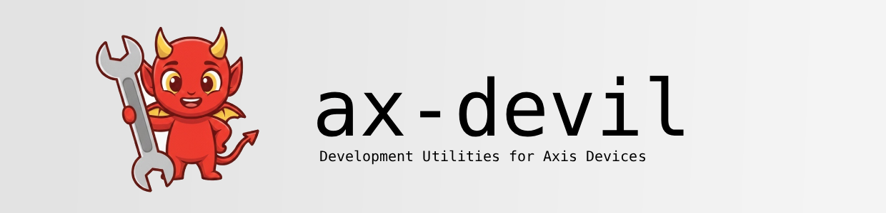

<p align="center">
  
</p>

**ax-devil** is a desktop app for viewing live Axis camera streams and offline recordings together with analytics
overlays, inspecting objects frame by frame, and comparing results side by side.

> **Being rebuilt.** This branch is a from-scratch rewrite in Rust, React and Electron; it plays local recordings
> with analytics overlays, comparison lanes and playlists, and supports shared sessions. Saved workspaces, live
> cameras, inspection and export remain unfinished. What it will do and in which
> order is in the [rebuild playbook](docs/rebuild/README.md); progress is in [docs/parity.md](docs/parity.md). The
> Python app it replaces is readable at commit `e31a7453`.

## Build from source

Requirements: Make, Node 24 (`.node-version`), the pnpm in `package.json`, curl, a C toolchain (`cc`) with clang and
`pkg-config`, and the FFmpeg 6.1+ development libraries (`libavcodec`, `libavformat`, `libavutil`, `libswscale`;
Debian/Ubuntu: `libavcodec-dev libavformat-dev libavutil-dev libswscale-dev`, macOS: `brew install ffmpeg`). Linux,
macOS and Windows (in Git Bash) build and package; the desktop tests need Linux with Xvfb. Rust comes from
[rustup](https://rustup.rs) if installed; otherwise `make` installs the pinned toolchain inside the checkout on first
use.

```bash
make desktop   # The app in an Electron window, with live reload
make web       # The same app at http://127.0.0.1:7331
make build     # Release build: target/release/ax-devil with the frontend embedded
make check     # The gate: every check and test suite
```

`make help` lists every target; there is no separate setup step. Testing is described in
[docs/runbooks/testing.md](docs/runbooks/testing.md).

## Contributing

Start with [AGENTS.md](AGENTS.md), which coding agents and people follow alike, then the
[architecture overview](docs/architecture/overview.md) and [module map](docs/architecture/module-map.md).

## License

[MIT](LICENSE). Icons: [Lucide](assets/icons/LICENSE), ISC.
