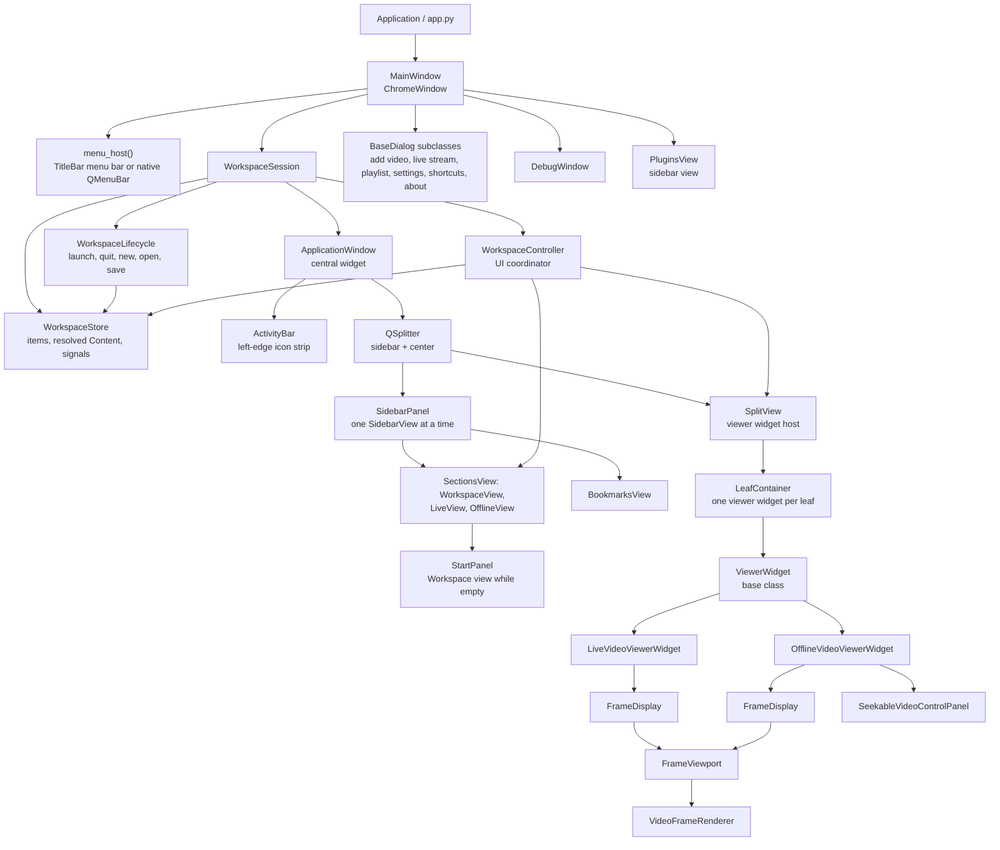
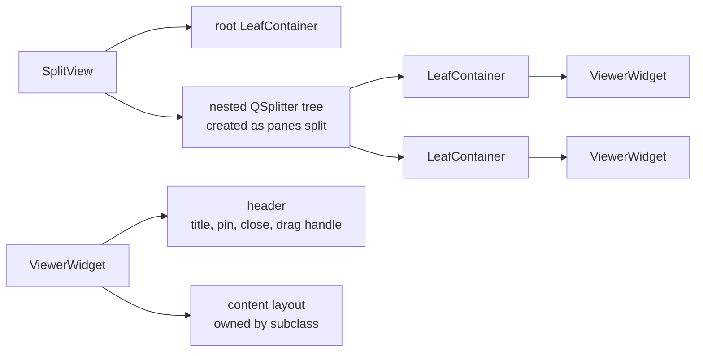
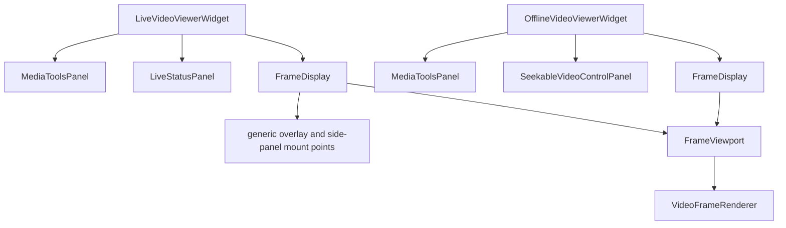

# UI Framework Structure

This document maps the current UI framework layer (code in `modules/workspace/ui/`; see [Workspace](workspace.md) for the `core`/`ui` split): windows, dialogs, Workspace composition, viewer hosting, and the display stack.

## Top-Level Composition

## Window Layer

`MainWindow` lives in `ax_devil.modules.application_shell`. It inherits from `ChromeWindow`, owns `WorkspaceSession`, installs shortcuts, creates menus, opens application dialogs, and hosts the session's `ApplicationWindow` as its central widget.

`ChromeWindow` and `BaseDialog` live in `ax_devil.modules.chrome`. With custom chrome enabled they install a shared `TitleBar` and `WindowFrameController`. `ChromeWindow.menu_host()` returns the title bar's menu bar or, with custom chrome disabled, the native `QMenuBar`; dialogs have no menu host and inherit custom-frame behavior from their parent top-level window. Their rules are in the [chrome README](../../src/ax_devil/modules/chrome/README.md).

## Workspace Shell

`WorkspaceSession` is the public Workspace facade and creates and wires the framework-level Workspace objects:

- `ItemResolver` and `WorkspaceStore`
- `WorkspaceLifecycle`
- `SplitView`
- `ApplicationWindow`
- `WorkspaceController`
- the Workspace, Live and Offline views with their controllers

Callers use the session to add Workspace Items (`add_items`, `add_resolved`, `open_files`), reach the workspace
lifecycle (`session.lifecycle`), route to the focused widget, configure shortcuts, and tear down. The lifecycle
— the unsaved-edits copy kept on quit, the New-workspace save question, and recent workspaces — is described in
[Workspace](workspace.md#lifecycle). The session re-emits the store's
`state_changed`, and `MainWindow` sets its window title from `workspace_name` and `is_modified`, and its custom `TitleBar` follows the
window title, so the name and the unsaved mark sit at the top whichever sidebar view is on screen. The store, views, split view, and controller are composed implementation details rather than
separate session APIs.

`ApplicationWindow` is the static central shell. It lays out the `ActivityBar`, the `SidebarPanel`, and `SplitView` in the center area. It owns only whether the sidebar shows, how wide it is and which view is on screen, not workspace state, teardown, or viewer behavior. The sidebar shows unless the user hid it with **View → Sidebar** (`Ctrl+\`), by clicking the button of the view on screen, or by dragging it closed; it always appears at the width the user last dragged it to. `ApplicationWindow` accepts desktop file drags that contain a video and emits `files_dropped`; the session pairs the files into `VideoFileSelection`s, turns them into Video Items, and asks for the data handler in a prefilled Add Video dialog only when several decoders may read the overlay. Pane drags carry their own MIME type and are accepted by `LeafContainer` before they reach this widget.

`WelcomeWidget`, shown by `SplitView` while no widgets are open, paints clickable rows. Shortcut rows come from `ShortcutManager` definitions marked `show_on_welcome` and trigger the same `QAction` as the menu and key binding. Recent workspaces are listed by `StartPanel`, which emits `recent_workspace_requested`.
The welcome screen scrolls when its rows cannot fit, keeping its actions reachable in small windows.

## Sidebar Views

The window is always in a Workspace. The activity bar has two zones, set apart by a rule:

- **The Workspace zone (top)** is the Workspace and its parts. The first button shows everything the Workspace holds;
  each other button shows one part of it, with the actions that belong to that part.
- **The app zone (bottom)** is the application, which does not change when another Workspace is opened. A view here
  never shows Workspace content.

| View | Zone | Group | Shows |
|------|------|-------|-------|
| Workspace | Workspace | Workspace | Everything the Workspace holds (`WorkspaceView`: the start panel while empty). |
| Live | Workspace | Sources | The Workspace's cameras with Start stream and Stop stream, and cameras found by startup or manual scans. |
| Offline | Workspace | Sources | The Workspace's videos and playlists, and the playlist resolvers that can add more. |
| Bookmarks | Workspace | Review | The moments marked in local videos and playlists, with each target's review state. |
| Plugins | App | App | What loaded, what failed, and adding, updating and removing plugins. |

The app zone also holds two buttons that are actions, not views: the render catalogs and Settings open dialogs, and the
sidebar stays as it was. Anything global that needs a sidebar of its own is a view in the `APP` group.

A view is a `SidebarView` value (`modules/chrome/sidebar_view.py`: id, title, icon, `ViewGroup`, widget). Its owner
builds the widget and registers it with `WorkspaceSession.add_sidebar_view`; the window only hosts it. Groups run in
the order of `ViewGroup`, a rule between them; the `WORKSPACE`, `SOURCES` and `REVIEW` groups order the Workspace
zone, and the `APP` group is the app zone, at the bottom of the bar above the app-wide actions. Clicking the
button of the view on screen hides the sidebar; any other button shows that view.

Views follow one pattern. The widget is thin: it renders plain data it is given and emits signals. A controller beside
it reads `WorkspaceController.sections()` and follows `sections_changed`, acts through `WorkspaceController`, and
changes items through `WorkspaceStore`; views never read the store directly. The widgets are built from the chrome kit
(`ViewPanel`, `SectionCaption`, `ListRow`, `SmallButton`, `Chip`, `Banner`) so spacing, text size and theme follow
the rest of the app.

The Workspace, Live and Offline views are one `SectionsView` (`sections_view.py`) each, fed by one
`SectionsViewController` (`sections_view_controller.py`); a view is the Workspace's sections of the kinds it is about,
plus what its concept adds. Workspace shows every section the Workspace holds (`HELD_SECTIONS`) and nothing it does
not hold. Live and Offline show their kinds, and their controllers (`LiveViewController`, `OfflineViewController`)
compose what is their own into them: cameras a scan found, what the scan learned about held cameras, and playlist
resolvers, whose Add runs the row's `add`.

`SectionsView` is also the one shell, with a fixed layout that views fill rather than change; see the
[workspace module README](../../src/ax_devil/modules/workspace/README.md#sidebar-view-shell).

Every view shows a browser row the same way. The row decides its look and offers its one action (`RowAction`: Start stream,
Stop stream, Rescan or Add); `SourceRow` (`source_row.py`) turns it into a `ListRow`, and `SectionTree`
(`section_tree.py`) lists sections of them under captions that fold on a click.
`WorkspaceController.connect_tree` serves every view's tree, so a row behaves the same in all
of them: a double-click opens a row that has something to open, its action runs through `perform_row_action`, and
its right-click menu (owned by `SectionTree`) offers, in groups split by separators, Open (plus the row's action, such as Start stream), Inspect (Information,
Export), Hide or Unhide (a hidden row stays listed, dimmed, and playback skips it), and Edit (Rename, Remove). A playlist row
starts expanded to its entries; its lane rows stay collapsed until an entry opens.

## Workspace Controller

`WorkspaceController` coordinates UI behavior between the sidebar views, `WorkspaceStore`, `SplitView`, and open `ViewerWidget` instances.

It owns the rows: Workspace mutations publish the rows projected by `build_browser_sections`
(`workspace/ui/browser_rows.py`) through `sections_changed`, and row intents are routed back to Workspace state or
viewer behavior.

Opening from the browser has two placements: replace the preview pane (`SplitView.replace_or_open`) or split the
focused pane and open pinned (`SplitView.open_to_side`).

Top-level browser rows are one per Content, or one unavailable row for an item that failed to resolve. **Rename** and
**Remove** act on the whole item, and a rename calls `ViewerWidget.set_display_name` on open viewers showing that Content, and offline viewers relabel
their render diagnostics with it.

Responsibilities:

- Open `SeekableVideoContent`, `LiveVideoContent`, or `PlaylistContent` through `WorkspaceViewerFactory`, placing the
  viewer in the preview pane or in a new split as the browser intent requests.
- Register which item each viewer widget's Content came from.
- Project each widget's current on-screen item into browser rows.
- Remove or rename the item a browser row asks for, and close every widget of a removed item.
- Tell the user which newly added items could not resolve, and why.
- Notify open viewers when consideration state changes.

Workspace content defines which entries and lanes support consideration. Offline viewer navigation reads that state through the narrow `ConsiderationQuery` contract; it does not depend on the mutable `WorkspaceStore` implementation.

`SplitView` is the visual container. `WorkspaceController` owns viewer selection, registration, and state coordination.

## Center Area

`SplitView` owns nested splitter structure, drag/drop splitting, focused widget tracking, and removal/collapse behavior.

Each `LeafContainer` hosts at most one `ViewerWidget`. Dragging starts from `ViewerWidget.get_header_widget()`. Dropping onto a leaf asks `SplitView` to move the widget there, splitting the leaf when it is occupied.

Unpinned panes are previews: their header title is italic, and `replace_or_open` replaces the first one with newly
opened content. Pinned panes keep a regular title and are never replaced; when every pane is pinned, new content opens
in a new split. `open_to_side` always adds a pinned pane to the right of the focused pane.

Framework-level signals:

- `widget_removed`

## Viewer Widget Contract

`ViewerWidget` is the base class for widgets hosted by `SplitView`.

It provides:

- header with display name
- pin and close icon buttons; an italic title marks an unpinned preview pane
- content layout for subclasses
- close routing through `close_requested`
- current item reporting through `current_on_screen_item()`
- consideration refresh hook through `refresh_item_consideration()`
- `cleanup()` hook, overridden by widgets that own runtime resources

Current concrete viewer widgets:

- `LiveVideoViewerWidget`: one `LiveVideoContent`; composes `FrameDisplay`, live status UI, `MediaToolsPanel`, and `StreamMediaController`.
- `OfflineVideoViewerWidget`: `SeekableVideoContent` or `PlaylistContent`; opens entries in the background through `LatestRequest` and `open_entry_media` and builds active entry runtimes through `OfflineSession`.

## Display Stack

`FrameDisplay` is the public reusable display shell. It owns a `FrameViewport`, forwards frame/overlay display and viewport state, and provides generic mount points for caller-owned widgets such as status overlays or side-panel tools. It does not own media sources, synchronization, Scene tools, live status semantics, or workflow actions.

`FrameViewport` is the lower-level viewing area. It extends `VideoFrameRenderer` with background/HUD painting, interactive viewport behavior, hover reporting, and visual widget-overlay positioning.

`VideoFrameRenderer` owns frame preparation and prepared-drawing submission.

Each lane's media tools live in its display's side panel. View-menu actions such as the media tools toggle and zoom
route to the focused viewer through `ViewerWidget` methods; shortcuts marked `acts_on_viewer` on their
`ShortcutDefinition` also work from lane fullscreen. Which lane an offline session targets is a
[viewer rule](../../src/ax_devil/modules/video_viewer/README.md#rules).

An overlay mounted on `FrameDisplay` with `preference` or `hide_while_info_shown` hands its visibility to
`FrameViewport`, which hides it while that `OverlayPreference` is off, or while the frame info overlay is shown,
respectively.

## Ownership Boundaries

- `MainWindow` owns application-wide actions, menus, shortcuts, dialogs, diagnostics windows, and the `WorkspaceSession`.
- `WorkspaceSession` owns Workspace composition, adding items, focused-viewer lookup, and teardown.
- `WorkspaceLifecycle` owns the workspace file lifecycle; it builds no widgets.
- `ApplicationWindow` owns the static central layout.
- `WorkspaceController` owns browser synchronization, UI coordination, viewer-to-item tracking, and lifecycle side effects.
- `SplitView` owns pane layout, focused viewer widget tracking, drag/drop splitting, and widget removal mechanics.
- `ViewerWidget` owns the common pane frame and lifecycle contract.
- Video Viewer workflows own media orchestration, playlist navigation, comparison layout, filtering tools, and workflow actions.
- `FrameDisplay` and `FrameViewport` own reusable display and viewport concerns.
- `VideoFrameRenderer` owns actual painting.

## Extension Points

- New center-pane tools should inherit from `ViewerWidget`, implement `get_display_name()` and `_setup_widget_ui()`, emit `on_screen_item_changed` when visible Workspace content changes, and override `cleanup()` if they own resources.
- New viewer widgets should be opened through `WorkspaceController`.
