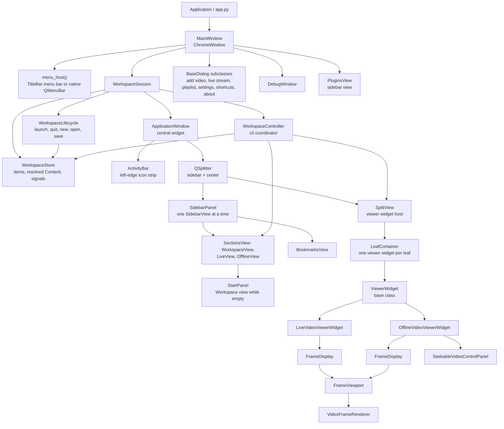

# UI Framework Structure

This document maps the current UI framework layer (code in `modules/workspace/ui/`; see [Workspace](workspace.md) for the `core`/`ui` split): windows, dialogs, Workspace composition, viewer hosting, and the display stack.

## Top-Level Composition

## Window Layer

`MainWindow` (`modules/application_shell`) owns `WorkspaceSession`, shortcuts, menus and application dialogs, and hosts
the session's `ApplicationWindow` as its central widget. `ChromeWindow` and `BaseDialog` (`modules/chrome`) carry the
shared frame; their rules are in the [chrome README](../../src/ax_devil/modules/chrome/README.md).

## Workspace Shell

`WorkspaceSession` is the one public Workspace facade. It creates and wires the objects in the diagram above; the store,
views, split view and controller are composed details, not separate session APIs. It owns adding content: the Add
dialogs, whoever opens them, pass their result to `add_items` or `add_resolved`, so every entry point adds items the
same way. The lifecycle (kept workspace, New-workspace save question, recents) is in
[Workspace](workspace.md#lifecycle). The window title carries the workspace name and unsaved mark, and the custom
`TitleBar` follows it, so both show whichever sidebar view is on screen.

`ApplicationWindow` is the static central shell: it owns whether the sidebar shows, its width and which view is on
screen, not workspace state, teardown or viewer behavior. It accepts desktop file drags that contain a video and emits
`files_dropped`; the session asks for the data handler in a prefilled Add Video dialog only when several decoders may
read an overlay. Pane drags carry their own MIME type and are accepted by `LeafContainer` before they reach it.

`WelcomeWidget`, shown by `SplitView` while no widgets are open, takes its shortcut rows from `ShortcutManager`
definitions marked `show_on_welcome`; a row triggers the same `QAction` as the menu and key binding.

## Sidebar Views

The zone rule (Workspace zone on top, app zone below) is in
[invariants](../domain/invariants.md#sidebar). A view's group sets its zone and order.

| View | Zone | Group |
|------|------|-------|
| Workspace (`WorkspaceView`; the start panel while empty) | Workspace | Workspace |
| Live | Workspace | Sources |
| Offline | Workspace | Sources |
| Bookmarks | Workspace | Review |
| Plugins | App | App |

The app zone also holds two buttons that are actions, not views: the render catalogs and Settings open dialogs, and the
sidebar stays as it was. Anything global that needs a sidebar of its own is a view in the `APP` group.

A view is a `SidebarView` value (`modules/chrome/sidebar_view.py`). Its owner builds the widget and registers it with
`WorkspaceSession.add_sidebar_view`; the window only hosts it. Groups run in the order of `ViewGroup`.

Views follow one pattern. The widget is thin: it renders plain data it is given and emits signals. A controller beside
it reads `WorkspaceController.sections()`, acts through `WorkspaceController`, and changes items through
`WorkspaceStore`; views never read the store directly. Widgets are built from the chrome kit so spacing, text size and
theme follow the rest of the app.

The Workspace, Live and Offline views are one `SectionsView` each, fed by one `SectionsViewController`: a view is the
Workspace's sections of the kinds it is about, plus what its concept adds. Workspace shows every section the Workspace
holds (`HELD_SECTIONS`) and nothing it does not hold. `LiveViewController` and `OfflineViewController` compose what is
their own into theirs: cameras a scan found, what the scan learned about held cameras, and playlist resolvers.

`SectionsView` is also the one shell, with a fixed layout that views fill rather than change; see the
[workspace module README](../../src/ax_devil/modules/workspace/README.md#sidebar-view-shell).

Every view shows a browser row the same way. The projection (`browser_rows.py`) decides a row's look and the
`RowAction`s it offers, each disabled with a reason where it cannot be done yet (Export until the row is open).
`SectionTree` has one outgoing request for a row, `row_action_requested(row, RowAction)`, whichever gesture asked. It
never checks that the row offers the action; `WorkspaceController.perform_row_action` does, and carries it out for every
view (`connect_tree`).

## Workspace Controller

`WorkspaceController` coordinates the sidebar views, `WorkspaceStore`, `SplitView` and open `ViewerWidget`s. It owns the
rows: Workspace mutations publish the rows projected by `build_browser_sections` through `sections_changed`, and row
intents are routed back to Workspace state or viewer behavior. It also tracks which item each open viewer's Content
came from, closes every widget of a removed item, and tells the user which newly added items could not resolve.

A row can be older than the Workspace, such as when a menu was open as its item was removed, so every action handler
does nothing for an item that is gone. **Rename** and **Remove** act on the whole item.

## Center Area

`SplitView` owns the nested splitter structure, drag/drop splitting, focused widget tracking and removal/collapse
behavior; `WorkspaceController` owns viewer selection and registration. Each `LeafContainer` hosts at most one
`ViewerWidget`; dropping onto an occupied leaf splits it.

Unpinned panes are previews, and `replace_or_open` replaces the first one with newly opened content. Pinned panes are
never replaced; when every pane is pinned, new content opens in a new split. `open_to_side` always adds a pinned pane
to the right of the focused pane.

## Viewer Widgets

`ViewerWidget` is the base class for widgets hosted by `SplitView`: the pane frame (header, pin, close), the
current-item report and the `cleanup()` hook, overridden by widgets that own runtime resources. A new center-pane tool
inherits from it, emits `on_screen_item_changed` when visible Workspace content changes, and is opened through
`WorkspaceController`. The concrete viewers are the live and offline video viewers in `video_viewer`.

## Display Stack

`FrameDisplay` is the public reusable display shell: it owns a `FrameViewport`, forwards frame and overlay display, and
offers generic mount points for caller-owned widgets such as status overlays or side-panel tools. It owns no media
sources, synchronization, Scene tools, live status semantics or workflow actions. `FrameViewport` is the viewing area
(background and HUD painting, interaction, hover reporting); `VideoFrameRenderer` owns frame preparation and
prepared-drawing submission.

Each lane's media tools live in its display's side panel. Shortcuts that act on the focused viewer call `ViewerWidget`
methods, which do nothing in viewers that lack the feature; shortcuts marked `acts_on_viewer` on their
`ShortcutDefinition` also work from lane fullscreen. Which lane an offline session targets is a
[viewer rule](../../src/ax_devil/modules/video_viewer/README.md#rules).

An overlay mounted on `FrameDisplay` with `preference` or `hide_while_info_shown` hands its visibility to
`FrameViewport`, which hides it while that `OverlayPreference` is off, or while the frame info overlay is shown,
respectively.

## Ownership Boundaries

- `MainWindow` owns application-wide actions, menus, shortcuts, dialogs and diagnostics windows.
- `WorkspaceSession` owns Workspace composition, adding content, focused-viewer lookup and teardown.
- `WorkspaceLifecycle` owns the workspace file lifecycle; it builds no widgets.
- `ApplicationWindow` owns the static central layout.
- `WorkspaceController` owns browser synchronization, viewer-to-item tracking and lifecycle side effects.
- `SplitView` owns pane layout, focus tracking, drag/drop splitting and widget removal.
- Video Viewer workflows own media orchestration, playlist navigation, comparison layout, filtering tools and workflow
  actions.
- `FrameDisplay` and `FrameViewport` own reusable display and viewport concerns; `VideoFrameRenderer` owns painting.
